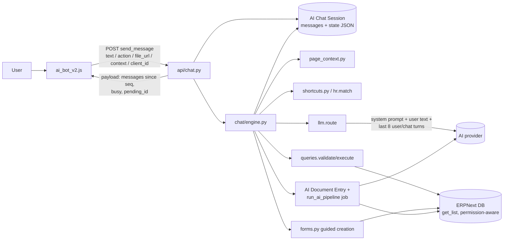

# AI chatbot architecture: overview

How the `ai_erpnext` chat assistant works, from the moment a user sends a message until the reply appears. This set of
documents was written by tracing the source code. Read it if you will debug, maintain or extend the assistant.

- Snapshot: branch `ai-implementation-phase` at `90dc039` (the same commit as `version-16`), 2026-10-23.
- Companion reports: [ERPNext_AI_IMPLEMENTATION_AUDIT.md](../ERPNext_AI_IMPLEMENTATION_AUDIT.md) (history of the
  implementation phases), [OPERATIONS_AND_RELEASE.md](../OPERATIONS_AND_RELEASE.md) (deployment) and
  [coverage_inventory.md](../coverage_inventory.md) (generated capability inventory).

## Evidence labels

Every claim in these documents is backed by one of these:

| Label | Meaning |
|---|---|
| **[code]** | Read in the source at the cited line. The behaviour follows from the code but was not executed for this document. |
| **[probe]** | Executed on the isolated test site `ci-test.local` with a read-only script (no AI call, no write; everything rolled back). See [test-coverage.md](test-coverage.md#read-only-probes-run-for-this-audit). |
| **[test]** | An automated test in `ai_erpnext/tests/` asserts it. Provider calls in tests are always mocked. |
| **[site]** | Read from the configuration metadata of the working site `ai-erpnext.local` (no record content). |
| **[unverified]** | Inferred. The evidence a confirmation needs is named. |

## The system in plain English

A floating chat button in ERPNext Desk opens a panel. Whatever the user types is sent to one server endpoint. The
server keeps the whole conversation and its working state in a database record. That record is the source of truth,
and the browser only displays it.

On the server, each message goes through a series of filters, in a fixed order:

1. **Fixed commands and pending questions.** "cancel", "start over", "help", "retry", corrections such as "change
   customer to X", and answers to the question the assistant last asked are handled by plain code.
2. **The page the user has open.** "Explain this invoice" or "summarise this list" is answered from the open record or
   list, re-read on the server with the user's permissions.
3. **Shortcuts.** Common, unambiguous phrasings are turned into a query plan by regular expressions, with no AI call.
   Examples: "hi", "show the last 10 sales invoices", "how many draft purchase invoices", "my leave balance",
   "mobile number of Amit Patel" and "create purchase order".
4. **The AI router.** Anything else goes to a language model. The model only *proposes* a JSON plan: chat, query,
   create, clarify, open, more or unsupported. It never sees ERPNext data, never writes SQL and never performs an
   action.
5. **Validation.** Every query plan, whether a shortcut or the model wrote it, is checked against an explicit allowlist
   of DocTypes, fields and operations. It is then run with Frappe's permission-aware `get_list`, limited to the user's
   companies. The answer text and numbers are built by code from the real results.
6. **Guided creation.** A creation request starts a form that asks one question at a time. Every answer is checked
   against real records. ERPNext's own validation runs on an unsaved copy, a preview is shown, and the record is
   inserted only after the user confirms. Transactions are saved as Drafts. Nothing is ever submitted, cancelled,
   deleted or paid.
7. **Images.** An attached document image (or a one-page PDF) is read by a vision model in a background job. Code then
   decides what the document is for the user's company, maps it to existing records and asks only about what is
   still unresolved. After confirmation it creates a Draft.

## Component map

| # | Component | Source | Entry points |
|---|---|---|---|
| 1 | Chat UI (launcher, panel, rendering, uploads, polling) | [public/js/ai_bot_v2.js](../../ai_erpnext/public/js/ai_bot_v2.js) | `send()` L374, `apply()` L396, `renderMessage()` L502 |
| 1a | Page context collector | [public/js/ai_page_context.js](../../ai_erpnext/public/js/ai_page_context.js) | `collectPageContext()`, `snapshotForm()` |
| 1b | Desk review UI for AI Document Entry (not the chat) | [public/js/ai_review.js](../../ai_erpnext/public/js/ai_review.js), [ai_document_entry.js](../../ai_erpnext/public/js/ai_document_entry.js) | `api.creation.create_document`, `api.mapping.*` |
| 2 | Chat HTTP API | [api/chat.py](../../ai_erpnext/api/chat.py) | `send_message` L41, `get_session` L30, `poll` L63, `new_conversation` L76, `list_conversations` L86, `open_conversation` L92 |
| 3 | Launcher visibility | [boot.py](../../ai_erpnext/boot.py) | `boot_session` sets `ai_chat_enabled` |
| 4 | Conversation storage, locking, expiry | [chat/session.py](../../ai_erpnext/chat/session.py) | `lock` L132, `state` L151, `save` L192 |
| 5 | Message engine (routing, image flow, answers) | [chat/engine.py](../../ai_erpnext/chat/engine.py) | `handle_message` L249, `_on_text` L419, `_general` L531 |
| 6 | Page-aware answers | [chat/page_context.py](../../ai_erpnext/chat/page_context.py) | `parse` L138, `classify` L508, `answer` L626 |
| 7 | Deterministic shortcuts | [chat/shortcuts.py](../../ai_erpnext/chat/shortcuts.py), [chat/hr.py](../../ai_erpnext/chat/hr.py) `match` L702 | `shortcuts.match` L274 |
| 8 | AI router (prompt, retries, parsing) | [chat/llm.py](../../ai_erpnext/chat/llm.py) | `route` L242, `complete_with_policy` L343 |
| 9 | Claims guard on model text | [chat/claims.py](../../ai_erpnext/chat/claims.py) | `guard` L110 |
| 10 | Capability policy and checks | [capability/policy.py](../../ai_erpnext/capability/policy.py), [capability/service.py](../../ai_erpnext/capability/service.py), [capability/access.py](../../ai_erpnext/capability/access.py) | `REGISTRY` (74 DocTypes), `normalize_where` L356, `assert_creation_safe` L555 |
| 11 | Read-only query engine | [chat/queries.py](../../ai_erpnext/chat/queries.py) | `validate` L163, `execute` L656 |
| 12 | HR (HRMS) queries and forms | [chat/hr.py](../../ai_erpnext/chat/hr.py) | `leave_balance` L206, `attendance` L316, `precheck` L450 |
| 13 | Guided creation forms | [chat/forms.py](../../ai_erpnext/chat/forms.py), [chat/requirements.py](../../ai_erpnext/chat/requirements.py) | `start` L902, `next_step` L1054, `_create` L2551 |
| 14 | Masters created inside the image flow | [chat/masters.py](../../ai_erpnext/chat/masters.py) | `create` L218 |
| 15 | Replay permission check | [chat/history.py](../../ai_erpnext/chat/history.py) | `recheck` L80 |
| 16 | Capability descriptions and offline guidance | [chat/capabilities.py](../../ai_erpnext/chat/capabilities.py) | `answer` L459, `creation_sentence` L398 |
| 17 | AI providers, retries, fallback | [ai/providers.py](../../ai_erpnext/ai/providers.py), [ai/policy.py](../../ai_erpnext/ai/policy.py), [ai/errors.py](../../ai_erpnext/ai/errors.py), [ai/openai_provider.py](../../ai_erpnext/ai/openai_provider.py), [ai/gemini.py](../../ai_erpnext/ai/gemini.py) | `providers.primary` L80, `providers.run` L117 |
| 18 | Image extraction pipeline | [pipeline/controller.py](../../ai_erpnext/pipeline/controller.py), [pipeline/processor.py](../../ai_erpnext/pipeline/processor.py), [pipeline/pdf.py](../../ai_erpnext/pipeline/pdf.py) | `run_ai_pipeline` L96 (background job) |
| 19 | Classification, mapping, validation, draft building | [detection/direction.py](../../ai_erpnext/detection/direction.py), [mapping/](../../ai_erpnext/mapping/), [validation/](../../ai_erpnext/validation/), [registry/](../../ai_erpnext/registry/), [creation/](../../ai_erpnext/creation/), [pipeline/review_service.py](../../ai_erpnext/pipeline/review_service.py), [api/creation.py](../../ai_erpnext/api/creation.py) | `apply_mapping` L63, `create_document` L11 |
| 20 | Hooks, schema, scheduler, retention | [hooks.py](../../ai_erpnext/hooks.py), [setup_doctypes.py](../../ai_erpnext/setup_doctypes.py), [pipeline/retention.py](../../ai_erpnext/pipeline/retention.py), [permissions.py](../../ai_erpnext/permissions.py) | `after_migrate`, `scheduler_events.daily` |

## Data flow and authority

Which component is authoritative at each stage:

| Stage | Authority | Not authoritative |
|---|---|---|
| Who the user is | Frappe session cookie (`frappe.session.user`) | Anything in the request body |
| Which conversation | `AI Chat Session` row owned by the user ([session.py:45](../../ai_erpnext/chat/session.py#L45)) | The browser's session id (re-checked on every call) |
| What is pending, what was answered | `state` JSON in the session row | The browser (it only sends `question_id` and `value`) |
| What the open page is | `page_context.parse` re-reads the record and filters with the user's permissions | The browser's `context` (a hint only) |
| What the message means | Deterministic code first, then the router model's plan | The model's plan is a proposal and is validated |
| What may be read | `capability/policy.py` ∩ DocType metadata ∩ the user's permissions and companies | The model or the prompt |
| Numbers and record names in answers | `queries.py` / `hr.py` from query results | The model (its text passes [claims.py](../../ai_erpnext/chat/claims.py)) |
| What a record will look like | `forms._doc_dict` / registry builders, then ERPNext `insert()` | The model's `values` (prefill hints, each re-resolved) |
| Whether a record is created | An explicit confirmation (button or "yes"-style reply) at the `form_confirm` / `confirm` question | Anything earlier in the conversation |
| What an uploaded document becomes | `detection/direction.py` + registry validators | The vision model's `document_type` |

## Documents in this set

| Document | Contents |
|---|---|
| [request-lifecycle.md](request-lifecycle.md) | End-to-end trace of one message, sequence diagram, branch-aware call graph |
| [routing-and-prequeries.md](routing-and-prequeries.md) | Every deterministic path before and after the AI router, with probe results |
| [parameters-and-context.md](parameters-and-context.md) | How parameters are extracted, defaulted, dropped and corrected, with the requested examples traced |
| [queries-and-permissions.md](queries-and-permissions.md) | Query planning, validation, permissions, company and employee scope, result formatting |
| [document-creation.md](document-creation.md) | Guided forms, image drafts, masters, confirmation, side effects |
| [providers-and-fallbacks.md](providers-and-fallbacks.md) | Provider configuration, prompts, retries, the six fallback layers |
| [frontend-api-contract.md](frontend-api-contract.md) | Endpoints, payloads, message/card schema, UI behaviour, mismatches |
| [background-jobs-and-hooks.md](background-jobs-and-hooks.md) | Hooks, scheduler, background job, transactions, side effects |
| [security-review.md](security-review.md) | Findings with severity, evidence and remediation |
| [test-coverage.md](test-coverage.md) | Test map, commands, results of the run made for this audit |
| [capability-matrix.md](capability-matrix.md) | What can be queried and created, per module and DocType |

## The most important findings

These are detailed in [security-review.md](security-review.md):

1. **The router call runs inside the web request while it holds a row lock on the conversation.** The worst case is
   about 3 × 90 s timeouts. In production behind gunicorn's 120 s limit, the request would be killed. [code]
2. **A confirmation reply that also contains a correction creates the record without the correction.** Examples:
   "ok, but change the date". [code]
3. **The HR shortcut keeps the period inside the employee search term.** "casual leave balance for Anshum for 2026"
   searches for an employee called "Anshum for 2026", fails, and never reaches the model. [probe]
4. **A Draft Leave Application is not side-effect free.** HRMS emails and shares it with the leave approver, and
   `send_leave_notification` is on for `ai-erpnext.local`. [code + site]
5. **The UI refuses PDFs although the server supports one-page PDFs and the help text advertises them.** [code]
