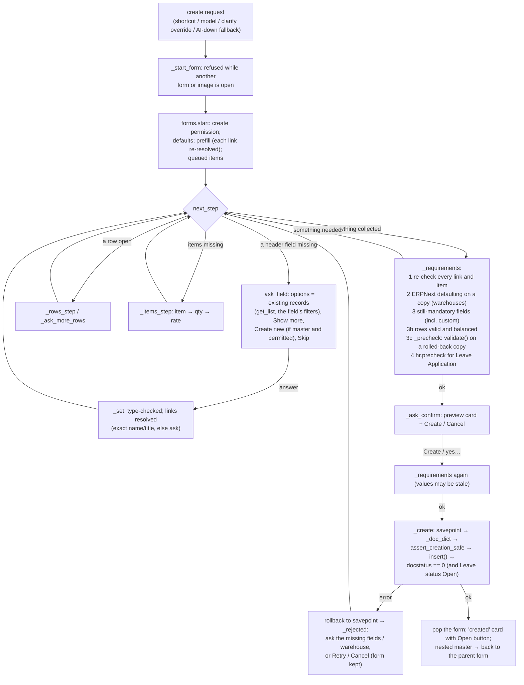

# Document creation and the Draft lifecycle

The chat can create records in two independent ways, plus a sub-flow for missing masters:

| Path | Code | DocTypes | Trigger |
|---|---|---|---|
| **Guided form** | [chat/forms.py](../../ai_erpnext/chat/forms.py) (`SPECS`, 24 types), [chat/requirements.py](../../ai_erpnext/chat/requirements.py), [chat/hr.py](../../ai_erpnext/chat/hr.py) | see the table below | "create X" (shortcut), a model `create` plan, the `clarify` override, or the AI-down fallback |
| **Image draft** | [chat/engine.py](../../ai_erpnext/chat/engine.py) image section, [pipeline/](../../ai_erpnext/pipeline/), [detection/direction.py](../../ai_erpnext/detection/direction.py), [mapping/](../../ai_erpnext/mapping/), [validation/](../../ai_erpnext/validation/), [registry/definitions.py](../../ai_erpnext/registry/definitions.py), [creation/transaction.py](../../ai_erpnext/creation/transaction.py), [api/creation.py](../../ai_erpnext/api/creation.py) | Sales/Purchase Invoice, Sales/Purchase Order, Quotation, Delivery Note, Purchase Receipt, credit note (Sales Invoice return), debit note (Purchase Invoice return), Material Request, BOM | an attached image or a one-page PDF |
| Masters on the way | guided: a nested `forms.start` with `return_to` ([forms.py:2000](../../ai_erpnext/chat/forms.py#L2000)); image: [chat/masters.py](../../ai_erpnext/chat/masters.py) + `_start_master` ([engine.py:2086](../../ai_erpnext/chat/engine.py#L2086)) | Customer, Supplier, Item | "Create new customer “X”" button or wording, only if the user may create it |

## Supported DocTypes (guided forms)

| DocType | Saved as | Party | Items / rows | Extra checks before the preview |
|---|---|---|---|---|
| Sales Invoice, Purchase Invoice, Quotation, Supplier Quotation | Draft | customer / supplier / `party_name` | selling / buying items, qty, rate | warehouse not needed (`update_stock` is never set) |
| Sales Order, Purchase Order, Delivery Note, Purchase Receipt | Draft | customer / supplier | items + per-row warehouse rules | `requirements.inspect` (ERPNext default warehouse per row) |
| Material Request, Stock Entry (receipt / issue / transfer) | Draft | – | items without prices | warehouse rules; the Stock Entry warehouses depend on its type |
| Leave Application (HRMS) | Draft, status **Open** | employee | – | `hr.precheck`: HRMS `validate()` on a rolled-back copy, then the balance and leave days |
| Expense Claim (HRMS), Timesheet | Draft | employee | `expenses` / `time_logs` rows | `_precheck`: ERPNext/HRMS `validate()` on a rolled-back copy |
| Work Order | Draft | – | taken from the item's default BOM | the BOM must be active and submitted; `_precheck` |
| Journal Entry (restricted) | Draft | – | ≥ 2 lines: account + debit/credit + amount | the accounts are non-group ledger accounts of the company, in the company currency, never Bank/Cash/Receivable/Payable/Stock; debits = credits; `_precheck` |
| Customer, Supplier, Item, Lead, Issue, Employee, Opportunity, Project, Task | **saved immediately** (no Draft state; `MASTERS`, [forms.py:743](../../ai_erpnext/chat/forms.py#L743)) | – | – | duplicate name check (Customer/Supplier/Item); `_precheck` for Employee |

The confirmation text says which kind of record it is: "It will not be submitted" for transactions, "It is saved
immediately: this record has no Draft state" for masters ([forms.py:2469](../../ai_erpnext/chat/forms.py#L2469)).

## How a form is specified

Each spec is a dict in `SPECS` ([forms.py:102](../../ai_erpnext/chat/forms.py#L102)):

- `party`: the party field;
- `items`: `selling | buying | stock | any | None`, selecting the item filters;
- `rates`: whether rows carry a price;
- `header`: a list of `F(...)` fields;
- `fixed`: values always set;
- `derived`: values the server fills from chosen records;
- `rows`: one generic child table with its own `F` fields and the exact output keys (`out`).

`F(fieldname, label, type, required, doctype, filters, default, ask, master, prompt, skip_label, when, options, positive)`
([forms.py:38](../../ai_erpnext/chat/forms.py#L38)):

- `ask` defaults to `required`, so an optional field is **not asked** unless `ask=True`. Example: a Sales Invoice
  `due_date` can only be set by "change due date to …". **[code]**
- `filters` may reference other values (`"$company"`, `"$company_currency"`). The filter is omitted until that value
  is known ([forms.py:1465](../../ai_erpnext/chat/forms.py#L1465)).
- `when` makes a field conditional (the Stock Entry source/target warehouses).
- For self-service HR forms, users without an HR role can only pick their own Employee
  ([forms.py:1476](../../ai_erpnext/chat/forms.py#L1476)).

## Lifecycle

### Stage by stage

| Stage | Function | What it guarantees |
|---|---|---|
| Intent | `engine._general` ([engine.py:542](../../ai_erpnext/chat/engine.py#L542)), model `create` (L617) | only DocTypes in `SPECS` (`forms.match_doctype`); others → `not_creatable` |
| Start | `forms.start` ([forms.py:902](../../ai_erpnext/chat/forms.py#L902)) | `has_permission(doctype, "create")`; HRMS DocTypes only with HRMS installed |
| Prefill | L934–966 | each prefilled link is accepted only if it matches exactly one record; otherwise it becomes the question ("Several customer records match …"). Unknown keys are dropped |
| Link answers | `_resolve_link` ([forms.py:1764](../../ai_erpnext/chat/forms.py#L1764)) | buttons: the exact name, re-checked with `get_list` + filters. Text: `CustomerMatcher` or `_GenericMatcher` (exact name, or exact title; partial matches are only suggestions) |
| Items | `_resolve_item` ([forms.py:1790](../../ai_erpnext/chat/forms.py#L1790)) | `ItemMatcher` (code, barcode, name, description), then `disabled = 0` and the sales/purchase/stock flag |
| Requirements | `_requirements` ([forms.py:2012](../../ai_erpnext/chat/forms.py#L2012)) | everything still valid before the preview **and again before insert** |
| Validation copy | `_precheck` ([forms.py:2694](../../ai_erpnext/chat/forms.py#L2694)), `hr.precheck` ([hr.py:450](../../ai_erpnext/chat/hr.py#L450)) | `_set_defaults`, `_validate_links`, `set_new_name`, create permission **for this document**, company in the usable companies, `before_validate`, `validate`, `_validate_mandatory`, all inside savepoint `ai_chat_form_check` / `ai_chat_leave_check`, which is **always rolled back** |
| Preview | `_ask_confirm` ([forms.py:2409](../../ai_erpnext/chat/forms.py#L2409)) | every value shown, with figures ERPNext/HRMS computed on the copy |
| Confirmation | `forms.answer` `form_confirm` ([forms.py:1127](../../ai_erpnext/chat/forms.py#L1127)) | the button, or a reply starting with yes/ok/confirm/create/sure/go ahead/do it/retry |
| Insert | `_create` ([forms.py:2551](../../ai_erpnext/chat/forms.py#L2551)) | savepoint `ai_chat_form`; `assert_creation_safe` (only allowlisted keys; never `docstatus`, `owner`, `workflow_state`, `amended_from` …); `insert()` with normal permissions and ERPNext validation; then `docstatus == 0` (and Leave status `Open`) or raise → rollback |
| Result | L2574–2664 | the form is popped, `last_created` is set, and a "created" card with an Open button. For a nested master, the parent's field is set and the parent continues |

**Nothing is ever submitted, cancelled, amended, deleted or paid.** No such call exists in the application code
(**[test]** `test_security_hardening.test_no_lifecycle_call_exists_in_application_code`, which greps the source; the
one allowed exception is `pipeline/controller.py: doc.save(ignore_permissions=True)` for the extraction result).

## Image drafts

The image flow needs no typed field collection. What the document *becomes* is decided on the server:

1. **Classification** (`detection/direction.py`): the kind of document (invoice, order, quotation …) comes from the
   extracted title. Who is seller and who is buyer comes from the issuer/recipient and seller/buyer names. Which side
   is *our* company comes from the user's choice or validated default company, never from the model alone. When it is
   unknown or contradictory, the user is asked about the company or role (`_q_classification`,
   [engine.py:1339](../../ai_erpnext/chat/engine.py#L1339)).
2. **Mapping** (`mapping/mapper.py`, `transaction.py`): permission-aware matchers for the party, items, UOM, currency,
   company, warehouse and tax template. The return invoice is looked up for credit and debit notes.
3. **Validation** (`validation/transaction.py`, `duplicate.py`, `totals.py`): blocking errors, data errors (totals
   that don't add up), and possible duplicates (the same party + bill number or remark, permission-aware).
4. **Questions** (`_plan`, [engine.py:1380](../../ai_erpnext/chat/engine.py#L1380)), one at a time, in this order:
   party → duplicate acknowledgement → BOM item → each row's item and UOM → dates → currency → warehouse → discount
   base → original invoice → material request purpose → other blockers → tax template → data-error acknowledgement.
   Answers are stored as `review_overrides` on the entry, then re-mapped.
5. **Preview** (`_ask_confirm`, L1699): the source document, your company's role, the Draft type, party, dates,
   currency, warehouse, discount, taxes, net total vs printed total, items.
6. **Create** (`_create_document`, L2250 → [api/creation.py:11](../../ai_erpnext/api/creation.py#L11)): row lock on
   the entry (`FOR UPDATE`), `ensure_not_created`, **re-map and re-validate from scratch**, refuse when blocked or not
   acknowledged, `builder.create_draft` → `insert()`, `docstatus == 0` check, `created_document` saved on the entry.
7. The builder ([creation/transaction.py](../../ai_erpnext/creation/transaction.py)) copies only
   `definition.supported_fields`. It sets `set_posting_time`, `ignore_pricing_rule = 1`, `update_stock = 0`,
   negative quantities for returns, a BOM inactive and not default, the taxes from the chosen template, and a remark
   naming the AI Document Entry and the source number.

## Worked examples

### Sales Invoice (guided)

"create sales invoice": customer (buttons) → company (defaulted, so not asked) → posting date (today, not asked) →
`due_date` (optional, not asked) → items (sales items; rate offered from the newest selling Item Price) → "Add
another item?" → `_requirements` (no warehouse rule for invoices) → preview ("Items total X before taxes. ERPNext
fills accounts, currency, price list and taxes …") → Create → Draft. If the posting date is not today,
`set_posting_time = 1`. **[test]** `test_chat_forms.test_purchase_invoice_step_by_step` (the Purchase Invoice
equivalent), `test_lifecycle_safety.test_guided_form_ignores_docstatus_from_the_model`.

### Sales Invoice (image)

Attach an invoice that your company issued to a customer. The job extracts it → classification makes it a Sales
Invoice (our company is the seller) → `_announce` card → questions → preview →
"Create draft Sales Invoice" → `create_document` → Draft with remarks "Created from AI Document Entry …". A second
confirmation (double click, retry) finds `created_document` under the row lock and stops. **[test]**
`test_lifecycle_safety.test_second_create_never_duplicates_the_draft`, `test_chat_agent.test_image_with_text_creates_draft_after_confirmation`.

### Sales Order

Like the invoice, plus a **delivery date** (required, asked). `delivery_date` is copied to every row. Stock items need
a warehouse: the ERPNext default per row when one applies (marked "ERPNext default" in the preview), otherwise a
question "Which warehouse will … be delivered from?". "use Stores warehouse" sets one warehouse for all stock rows.
**[test]** `test_chat_creation_requirements` (17 tests).

### Leave Application

"apply for leave":

1. Employee: defaulted to the user's own active Employee when exactly one exists. Without an HR role, only one's own
   Employee can be chosen.
2. Leave type, then from date.
3. To date: offers "Same day" and, when the user named a duration via the model, "N calendar days from …".
4. Reason (skippable).
5. `hr.precheck` runs HRMS `validate()` on a rolled-back copy: balance, overlap, block days, approver rules. Its notes
   are shown.
6. Preview: leave days and the balance from HRMS, the approver, "Status: Open (Draft, awaiting approval)".
7. Create: `insert()`, and the status must still be `Open`.

**[test]** `test_chat_hr.test_guided_leave_application_is_a_draft_created_only_after_confirmation`,
`test_prefilled_request_never_submits_or_approves`.

**Side effects of this Draft** (from HRMS's own code, `apps/hrms/hrms/hr/doctype/leave_application/leave_application.py`
L106–137 and `apps/hrms/hrms/mixins/pwa_notifications.py` L33, outside this repository):

- `after_insert` → `notify_approver`: a **PWA Notification** to the approver;
- `on_update` → an **email** to the leave approver when HR Settings `send_leave_notification` is on (**it is on for
  `ai-erpnext.local`** **[site]**), a **DocShare** giving the approver submit access when they lack it, and a
  realtime `publish_update`.

The chat's confirmation text says the application "will not be submitted or approved". It does not say the approver
is notified. **[code]**

### Journal Entry (restricted, additional example)

"create journal entry":

1. Company (defaulted), posting date (today), remark (skippable).
2. Lines, each with an account, debit or credit, and a positive amount. The account options are filtered to the
   company's non-group, enabled, non-frozen accounts in the company currency, excluding Bank/Cash/Receivable/Payable/Stock.
3. "Add another line?" until at least 2 lines exist and debits equal credits (`_rows_problem`,
   [forms.py:2351](../../ai_erpnext/chat/forms.py#L2351)).
4. `_precheck` runs ERPNext's JE validation. It also runs HRMS's `validate_expense_claim_in_jv` doc_event.
5. Preview with the total debit and credit, then a Draft.

A Draft Journal Entry posts nothing to the ledger. **[test]** `test_chat_new_forms` (18 tests).

## Masters vs transactions

- Customer, Supplier, Item, Lead, Issue, Employee, Opportunity, Project and Task are **saved immediately**. The same
  explicit confirmation is required ("Create Customer").
- A customer/supplier called the same (or nearly the same, via `CustomerMatcher`) as an existing one is refused
  ("already exists, so I won't create a duplicate"). An item code that already exists is refused.
- Inside a transaction form, "Create new …" is a separate button, offered only when the user may create that master.
  A name that matches nothing is never created automatically.
- In the image flow, `masters.find_existing` first offers "Use existing X". `masters.create`
  ([masters.py:218](../../ai_erpnext/chat/masters.py#L218)) rejects protected fields, then calls `insert()` inside
  savepoint `ai_chat_master`.
- Employee creation stores the date of birth and gender (both mandatory in ERPNext). HRMS `Employee` hooks run on
  insert (`after_insert` ×3, `on_update` ×2, `validate`).

## Idempotency and duplicates

| Risk | Protection | Evidence |
|---|---|---|
| Double click / network retry of the same message | `client_id` deduplication returns the original reply | [engine.py:253](../../ai_erpnext/chat/engine.py#L253), **[test]** `test_chat_sessions.test_duplicate_delivery_still_returns_the_original_reply` |
| Two tabs on the same conversation | the `FOR UPDATE` lock on the session row; after the first create, the form is popped, so the second "yes" has nothing to confirm | [session.py:132](../../ai_erpnext/chat/session.py#L132) **[code]** |
| Image confirmed twice | the row lock on the entry + `created_document` | **[test]** above |
| The same invoice uploaded twice | duplicate detection asks for an acknowledgement | `validation/duplicate.py` |
| The same guided document typed twice ("create sales order …" twice) | **none**: two Drafts can be created | **[code]** |
| A retry after a timeout | if the first request committed, the same `client_id` replays its reply; if it was killed before the commit, nothing was created and the retry runs again | **[code]** |

## Failure and recovery

- **The insert fails.** The rollback to the savepoint keeps the conversation and the form. `requirements.explain`
  ([requirements.py:142](../../ai_erpnext/chat/requirements.py#L142)) classifies the error:
  - `mandatory` → asks the missing fields it can collect, including site custom fields;
  - `warehouse` → asks a warehouse for the named rows;
  - `link` / `other` → "ERPNext didn't accept the X: …" with Retry / Cancel.

  A Python error (`builtins`) is logged by type only, and the user sees "an unexpected error occurred …".
- **An image draft is rejected.** `_creation_failed` ([engine.py:2285](../../ai_erpnext/chat/engine.py#L2285))
  re-plans. If the plan comes back to the same confirmation, it offers Retry / Cancel instead.
- **Resumable.** The form state is in the session row, so the next message continues it. After a browser *reload*,
  the conversation must be reopened from the history list (see
  [frontend-api-contract.md](frontend-api-contract.md#conversation-handling-in-the-browser)).
- **Cancel / restart / switch.**
  - "cancel" drops all forms (or only the nested one at its confirm step).
  - "start over" restarts the outermost form empty.
  - "I meant Purchase Receipt" switches and keeps the compatible values and rows.
  - In the image flow, "start over" clears the answers but keeps what was extracted (no new AI call).

## Can normal conversation enter the creation path by accident?

- Starting a form needs a create command (anchored regex), a model `create` plan, or a model `clarify` for a message
  that names a creatable DocType. A form only asks questions; **no record is written until the confirmation step**.
- At the confirmation step, a reply that merely *starts* with "ok", "yes", "sure" or "create" confirms, even when it
  continues with a correction. See [security-review.md](security-review.md#f2-medium-a-confirmation-with-a-correction-creates-the-record-unchanged).
- The prompt tells the model never to clarify to collect creation details ([llm.py:221](../../ai_erpnext/chat/llm.py#L221)).
  The engine forces creation-like `clarify` answers into the guided form, so the model never collects field values in
  free text.
