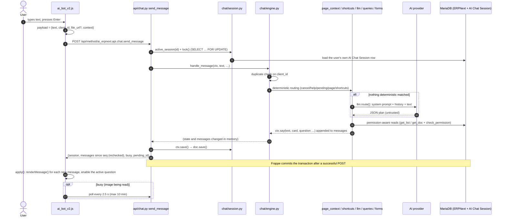
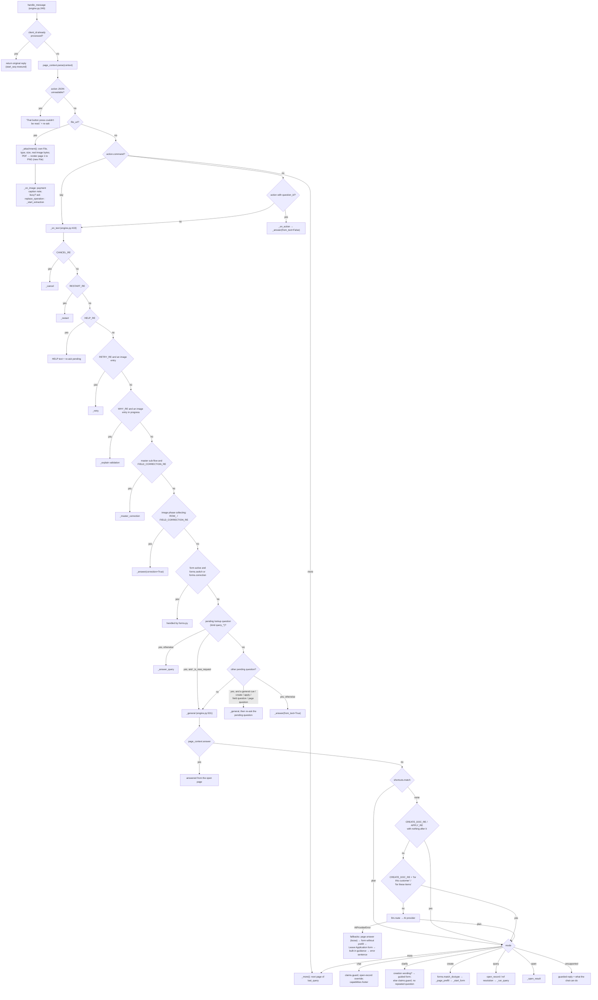

# Request lifecycle: one message from start to finish

This traces a normal text message from the browser event handler to the rendered reply. The evidence labels are
explained in the [README](README.md#evidence-labels). Unless stated otherwise, everything here is **[code]**.

## High-level sequence

## Step by step

| # | File and function | Input | Output | State used | AI? | ERPNext data? | Writes? | Errors and fallbacks | Next |
|---|---|---|---|---|---|---|---|---|---|
| 1 | [ai_bot_v2.js:785](../../ai_erpnext/public/js/ai_bot_v2.js#L785) `keydown` → `$form.on("submit")` L791 | Enter in textarea | `payload = {text, client_id: uid()}`, plus `file_url` when an upload finished | `S.attachment` | no | no | clears the input and the attachment | the send button is disabled while sending or uploading | `send()` |
| 2 | [ai_bot_v2.js:374](../../ai_erpnext/public/js/ai_bot_v2.js#L374) `send(payload)` | payload | adds `session` (in-memory id) and `context` = JSON of `collectPageContext()` | `S.session`, `cur_frm`, `cur_list` | no | no | `S.lastPayload` | a context error becomes `context = null` | `call("send_message")` |
| 3 | [ai_bot_v2.js:325](../../ai_erpnext/public/js/ai_bot_v2.js#L325) `call()` | method, args | `frappe.call({type: "POST"})` | `S.gen` (drops late replies for another conversation) | no | no | none | on HTTP error: "The request didn't go through." with **Retry**, which re-sends the same payload and `client_id` | server |
| 4 | Frappe request handler | POST form data | calls the whitelisted method | session cookie, CSRF header (added by `frappe.call`) | no | auth | no | Guest → 403; the method only accepts POST ([api/chat.py:40](../../ai_erpnext/api/chat.py#L40)) | `send_message` |
| 5 | [api/chat.py:41](../../ai_erpnext/api/chat.py#L41) `send_message` | `session, text, file_url, action, client_id, context` | payload dict | | no | | | `SessionClosed` → `{"closed": true}` (L53); any other exception → HTTP error and rollback | `_ctx(active=True)` |
| 6 | [api/chat.py:18](../../ai_erpnext/api/chat.py#L18) `_ctx` → [session.py:71](../../ai_erpnext/chat/session.py#L71) `active_session` → [session.py:132](../../ai_erpnext/chat/session.py#L132) `lock` | session id | `engine.Ctx(doc)` | `AI Chat Session` row | no | reads own row | **row lock** `FOR UPDATE`, held until commit | missing or foreign id → `PermissionError("Conversation not found.")`; closed or expired → `SessionClosed` | `Ctx.__init__` |
| 7 | [engine.py:182](../../ai_erpnext/chat/engine.py#L182) `Ctx` | doc | `msgs`, `st` (sanitised by [session.py:151](../../ai_erpnext/chat/session.py#L151)), `start_seq` | `messages`, `state` JSON | no | no | no | malformed `pending`/`forms` are dropped | `handle_message` |
| 8 | [engine.py:249](../../ai_erpnext/chat/engine.py#L249) `handle_message` | as above | appends messages and changes `st` | `processed`, `replies` | no | page context reads | | duplicate `client_id` → returns the original reply without processing (L253); unreadable action → "That button press couldn't be read." (L267) | branch, see below |
| 9 | [page_context.py:138](../../ai_erpnext/chat/page_context.py#L138) `parse` | `context` JSON (≤ 6000 chars) | `PageContext` or `None` | | no | **yes**: re-reads the record, list selection and report with permission-aware queries | no | any exception → `None` (L145) | sets `ctx.page`, `ctx.view` |
| 10 | [engine.py:419](../../ai_erpnext/chat/engine.py#L419) `_on_text` | cleaned text (≤ 2000 chars) | | `pending`, `forms`, `entry`, `phase`, `master` | no | some branches | | see [routing-and-prequeries.md](routing-and-prequeries.md) | `_general` or an answer handler |
| 11 | [engine.py:531](../../ai_erpnext/chat/engine.py#L531) `_general` | text | a plan dict | `last_query`, `ctx.page` | **only if** no shortcut matched (L557) | via handlers | | `AIProviderError` → layered fallback (L560–581) | mode dispatch L582–658 |
| 12 | [llm.py:242](../../ai_erpnext/chat/llm.py#L242) `route` | history, text, `last_query`, page summary | plan with a valid `mode` | | **yes**: one provider call, up to 3 attempts | no (the prompt holds no records) | no | see [providers-and-fallbacks.md](providers-and-fallbacks.md) | back to `_general` |
| 13a | [engine.py:842](../../ai_erpnext/chat/engine.py#L842) `_run_query` → [queries.py:163](../../ai_erpnext/chat/queries.py#L163) `validate` → [queries.py:656](../../ai_erpnext/chat/queries.py#L656) `execute` | plan | `{text, card, names, titles, …}` | | no | **yes**, read-only | `st.last_query` | `QueryClarify` → a question; `QueryError` → its sentence; `PermissionError` → "You don't have permission to view that."; anything else → logged by type and "I couldn't run that query." | `ctx.say(source="erpnext")` |
| 13b | [forms.py:902](../../ai_erpnext/chat/forms.py#L902) `start` / [forms.py:1054](../../ai_erpnext/chat/forms.py#L1054) `next_step` | DocType, prefill | a question (`ctx.ask`) | `st.forms` | no | **yes**: suggestions, link checks, ERPNext defaulting and validation on rolled-back copies | only at confirm, in `_create` | see [document-creation.md](document-creation.md) | waits for the next message |
| 14 | [engine.py:227](../../ai_erpnext/chat/engine.py#L227) `Ctx.save` → [session.py:192](../../ai_erpnext/chat/session.py#L192) `save` | | | | no | no | **writes the session row** (messages trimmed to 200, processed ids to 100; unsaved form values stored as a placeholder) | | `payload` |
| 15 | [engine.py:230](../../ai_erpnext/chat/engine.py#L230) `Ctx.payload` → [history.py:80](../../ai_erpnext/chat/history.py#L80) `recheck` | `since` | `{session, messages, busy, pending_id}` | | no | **yes**: stored ERPNext results are re-checked against the reader's current permissions | no | unreadable → "This earlier result is no longer available to you." | HTTP response |
| 16 | Frappe | | JSON `{"message": payload}` | | | | **commit** (POST) | exception → rollback of everything, including the session row | browser |
| 17 | [ai_bot_v2.js:396](../../ai_erpnext/public/js/ai_bot_v2.js#L396) `apply` → `renderMessage` L502 | payload | DOM | `S.lastId` (skips messages already shown) | no | no | | `closed` → starts a new conversation and puts the typed text back (L397–419) | `setBusy` → polling |

### What the transaction means

- The whole message runs in one database transaction. It commits only after the reply has been built. If an
  exception escapes `handle_message`, Frappe rolls back everything: the user's message, the assistant's reply and the
  state change. The browser shows "The request didn't go through", and **Retry** re-sends the same `client_id`.
  Because nothing was committed, the retry is processed again from scratch. **[code]**
- The `FOR UPDATE` lock in step 6 serialises double clicks, retries, polls and two tabs showing the same conversation
  ([session.py:132](../../ai_erpnext/chat/session.py#L132)). The lock is held for the whole request, including the AI
  call in step 12. See [security-review.md](security-review.md#f1-medium-long-ai-call-inside-a-locked-request) for what
  that means under load. **[code]**
- Creation and validation use savepoints inside this transaction: `ai_chat_form`, `ai_chat_form_check`,
  `ai_chat_leave_check`, `ai_chat_create` and `ai_chat_master`. A failed insert rolls back to its savepoint, so the
  conversation still saves. **[code]**

## Branch-aware call graph

The order of the checks matters: the first one that matches handles the message.

## The image path (asynchronous)

1. `_start_extraction` ([engine.py:1158](../../ai_erpnext/chat/engine.py#L1158)) inserts an `AI Document Entry`
   with `status=Pending`. Its `before_save` hook ([pipeline/controller.py:37](../../ai_erpnext/pipeline/controller.py#L37))
   enqueues `run_ai_pipeline` after the commit, with a deduplicated job id `ai-extract-<entry>`. The reply sets
   `phase=extracting`, so the payload has `busy: true`.
2. The browser polls `poll` every 2.5 s ([ai_bot_v2.js:437](../../ai_erpnext/public/js/ai_bot_v2.js#L437)).
   `engine.poll` ([engine.py:326](../../ai_erpnext/chat/engine.py#L326)) does nothing while the entry is `Pending`. If
   the job vanished for more than 180 s, the entry is re-queued once, then marked Failed
   (`_resume_if_lost`, L352).
3. The worker ([pipeline/controller.py:96](../../ai_erpnext/pipeline/controller.py#L96)) checks that the user can read
   the file and that the bytes are a real image. It calls the vision model (up to 3 attempts within 60 s, with the
   paid fallback only for an exhausted Groq daily quota), then runs `apply_mapping`. It saves the entry with
   `ignore_permissions=True` and commits.
4. The next poll sees a status other than Pending. `_announce` shows a summary card, and `advance` / `_plan`
   ([engine.py:1311](../../ai_erpnext/chat/engine.py#L1311), L1380) asks the first unresolved question, or
   `_ask_confirm` shows the draft preview.
5. The user confirms. `_create_document` (L2250) calls `api.creation.create_document`, which locks the entry row,
   re-maps and re-validates, then `builder.create_draft` → `insert()`.

## What the reply contains

`Ctx.payload` returns `{session, messages, busy, pending_id}`. Each message is
`{id, role, ts, text?, card?, question?, links?, suggestions?, attachment?, source?}`. The full schema is in
[frontend-api-contract.md](frontend-api-contract.md#message-object).
